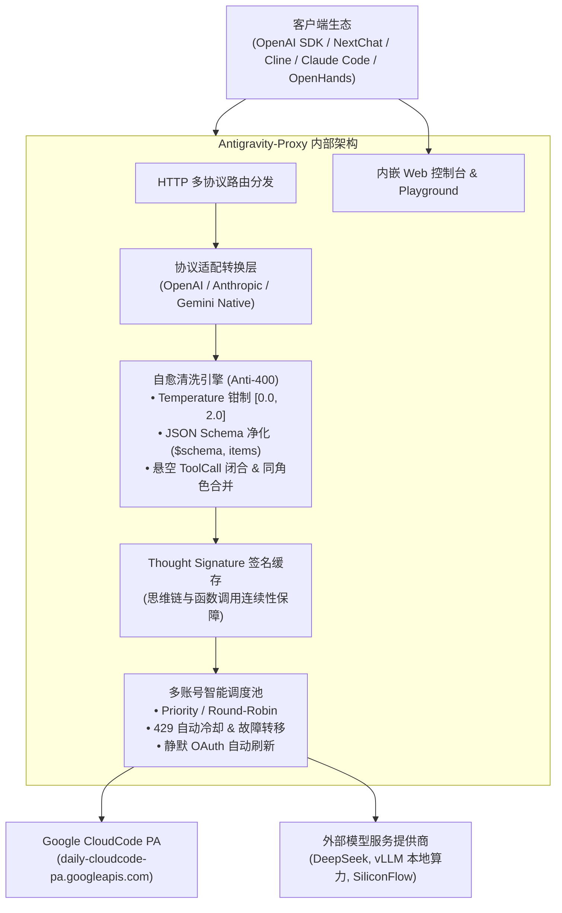

# ⚡ Antigravity-Proxy

<p align="center">
  <strong>Universal Multi-Protocol Gateway & Self-Healing Proxy for Google CloudCode & Gemini 3.8 / Claude</strong>
</p>

<p align="center">
  <a href="https://github.com/HelloaZelda/antigravity-proxy/releases"></a>
  <a href="LICENSE"></a>
  
  
</p>

---

## 🌟 What is Antigravity-Proxy? (这是什么？)

**Antigravity-Proxy** 是专为 **Google CloudCode / Vertex AI 内部流式推理网关** 打造的高性能、自愈型多协议聚合代理。

它彻底解决了在第三方客户端（如 **NextChat**, **LobeChat**, **Claude Code**, **OpenHands**, **Cursor**, **Cline**, **Cherry Studio** 等）中调用 Gemini 3.8 与 Claude 思考模型时，频发的 **`400 INVALID_ARGUMENT` 报错**、**Thought Signature（思维链签名）丢失**、**上下文悬空断裂** 以及 **多账号风控限流** 等难题。

---

## ✨ Key Features (核心特性)

* 🌐 **Triple Protocol Adapters (三协议全兼容)**:
  * **OpenAI 兼容**: `/v1/chat/completions` (流式 SSE + 非流式), `/v1/models`
  * **Anthropic 兼容**: `/v1/messages` (完整映射 thinking block 与 tool_use)
  * **Gemini 原生 REST**: `/v1beta/models/{model}:generateContent` (直接赋能官方 Google SDK)
* 🛡️ **Self-Healing Anti-400 Sanitizer (自愈清洗引擎)**:
  * **数值钳制**: 自动将客户端非标 `temperature` 钳制在 `[0.0, 2.0]`，纠正越界 `max_tokens`
  * **Tool Schema 净化**: 自动剥离 Google 不支持的 `$schema`, `additionalProperties`, 自动修复缺失 `items` 的 `array`，剔除幽灵 `required` 字段
  * **会话自愈 (Auto-Repair)**: 自动合并连续同角色消息；当客户端上一轮未正常回传 `tool` 结果时，自动闭合悬空 Tool Call，防止会话永久死锁
* 🔑 **One-Click Interactive OAuth CLI (一键扫码/网页登录)**:
  * 告别抓包与手动折腾 Refresh Token！只需运行 `antigravity-proxy auth login`，自动调起浏览器完成授权并秒级保存配置。
* 🧠 **Persistent Thought Signature Engine (思维链签名引擎)**:
  * 全自动捕获并缓存 `thoughtSignature`，保证 Gemini 3.8 / 3.7 / 3.1 跨轮次推演与工具调用 100% 连续。
* 👥 **Smart Multi-Account Pool (智能多账号风控轮询)**:
  * 支持 `priority` (主备优先), `round-robin` (轮询分流), `sticky` (会话粘性)
  * 遇到 429 自动进入阶梯冷却并无感故障转移，遇到 403 自动隔离故障账号。
* 📊 **Embedded Modern Web Console (内嵌现代管理面板)**:
  * 零外部静态依赖，单二进制文件内嵌 Web 控制台与 Playground 在线测试器。
* 🚀 **Zero Dependency Single Binary (单文件极简部署)**:
  * 仅 ~10MB 运行内存，冷启动 < 10ms，跨平台编译，支持 Docker 一键拉起。

---

## 🏛️ Architecture (架构全景图)



---

## 🚀 Quick Start (快速开始)

### 1. 快速下载二进制文件

前往 [Releases 页面](https://github.com/HelloaZelda/antigravity-proxy/releases) 下载适合您操作系统的预编译单二进制文件。

### 2. 准备配置文件

从示例模板复制：
```bash
cp config.example.json config.json
```

在 `config.json` 中填入您的 Google OAuth `client_id` 与 `client_secret`。

### 3. 一键登录授权 Google 账号

运行内置交互式登录命令：
```bash
./antigravity-proxy auth login
```
终端将自动弹出或打印授权链接，在浏览器完成授权后，`refresh_token` 会自动持久化写入 `config.json`！

### 4. 启动服务

```bash
./antigravity-proxy -config config.json
```

服务启动后：
* **OpenAI 接口地址**: `http://127.0.0.1:8080/v1`
* **Anthropic 接口地址**: `http://127.0.0.1:8080`
* **Web 控制台与测试器**: `http://127.0.0.1:8080`

---

## 🐳 Docker 部署

```bash
# 1. 准备配置文件
cp config.example.json config.json

# 2. 使用 docker-compose 启动
cd deploy
docker compose up -d
```

---

## ⚙️ 配置说明 (Configuration Guide)

完整 `config.json` 结构示例：

```json
{
  "port": 8080,
  "api_key": "sk-your-proxy-key",
  "client_id": "YOUR_CLIENT_ID.apps.googleusercontent.com",
  "client_secret": "YOUR_GOOGLE_CLIENT_SECRET",
  "project_id": "aicode-consumers",
  "upstream_url": "https://daily-cloudcode-pa.googleapis.com",
  "routing_mode": "priority",
  "accounts": [
    {
      "email": "user1@example.com",
      "refresh_token": "1//...",
      "project_id": "aicode-consumers"
    },
    {
      "email": "user2@example.com",
      "refresh_token": "1//...",
      "project_id": "aicode-consumers"
    }
  ],
  "providers": [
    {
      "name": "deepseek",
      "base_url": "https://api.deepseek.com",
      "api_key": "sk-...",
      "models": ["deepseek-chat", "deepseek-reasoner"],
      "protocol": "openai"
    }
  ]
}
```

---

## 🎯 推荐接入模型列表

| 客户端传入模型名 | 网关映射上游底座 | 特性描述 |
| :--- | :--- | :--- |
| `gemini-3.8-flash-high` | `gemini-3.8-flash-high` | 顶格思考预算，主力高智商推演与全能编程 |
| `gemini-3.8-thinking` | `gemini-3.8-flash-high` | 兼容 OpenAI / Anthropic 思维链直接透传 |
| `gemini-3.8-flash-medium` | `gemini-3.8-flash-medium` | 中等思考预算，极速平衡 |
| `gemini-3.8-flash-low` | `gemini-3.8-flash-low` | 零/低思考延迟，秒级直出 |
| `gemini-2.5-flash` | `gemini-2.5-flash` | 经典极速通用底座 |
| `claude-3-7-sonnet` | `claude-sonnet-4-6` | Claude 3.7 格式兼容映射 |
| `claude-sonnet-4-6` | `claude-sonnet-4-6` | 原生 Claude 4.6 编程特化 |
| `claude-opus-4-6-thinking` | `claude-opus-4-6-thinking` | 全血长思考推演旗舰 |

---

## 🤝 Contributing & License

欢迎提交 Issue 和 Pull Request！
本项目遵循 [MIT License](LICENSE) 开源协议。
